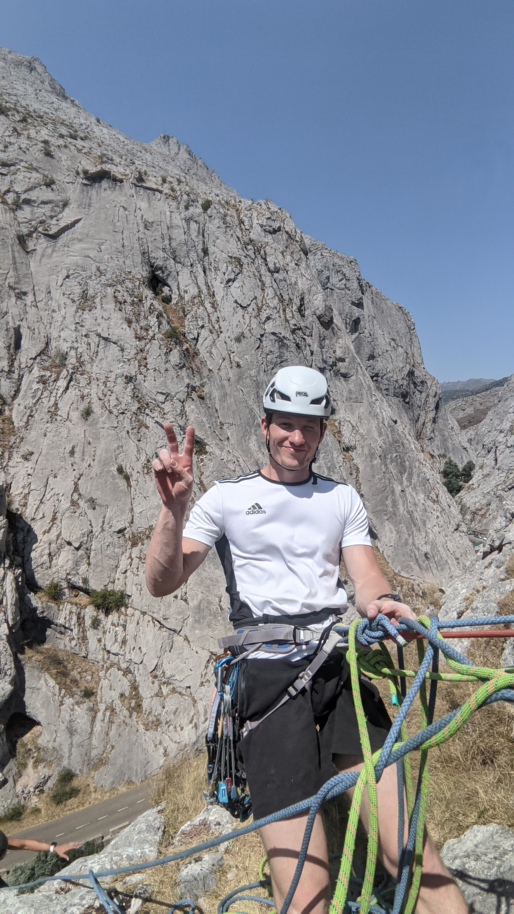

<section class="hola">
  
  

    <h1>Hola, soy Fabio.</h1>
    
Estudio Ingeniería Mecánica en la Universidad de Vigo, con la mención en Diseño y Fabricación, y solo me queda el TFG: el diseño de un criostato modular para los sensores de luz del experimento de neutrinos DUNE.

    
Trabajo como ingeniero mecánico en <a href="/oficina-tecnica">EINGAL</a>, una oficina técnica de Pontevedra: diseño en Inventor, calculo con Nastran y hago certificados energéticos con CE3X. Fuera del trabajo construyo cosas: un simulador de conducción con el motor de un patinete, un servidor que lleva la domótica de mi casa o un bot de trading que me enseñó más por lo que falló que por lo que ganó.

    
En cada proyecto cuento cómo lo hice, qué salió mal y qué aprendí.

    

      <a class="boton lleno" href="/proyectos/">Ver proyectos</a>
      <a class="boton" href="/resume/">Currículum</a>
    

  

</section>

<h2 class="seccion-titulo">Proyectos</h2>

Elige uno para ver los detalles.









<section class="sobre" id="sobre-mi">
  

    <h2>Sobre mí</h2>
    
Me gusta entender las cosas construyéndolas. Lo que no sé lo aprendo por el camino, y casi siempre equivocándome primero: el sensor de fuerza que mecanicé en aluminio no medía bien, el backtest de mi bot daba ganancias imposibles y el termómetro de casa estaba al sol. De cada error salió algo que ahora hago de otra manera.

    
Empecé a escalar en 2020 y, de septiembre de 2024 a julio de 2026, entrené como voluntario al equipo de competición del Grupo de Montaña Alud. De ahí salió, por ejemplo, el sensor de fuerza de dedos.

    
De 2018 a 2025 trabajé todos los veranos de peón de albañil: hacer masa, mover material y ayudar al capataz.

  

  

    <h3>Con qué trabajo</h3>
    <dl>
      <dt>Diseño</dt><dd>Autodesk Inventor, SolidWorks, Fusion 360, AutoCAD. Planos de fabricación.</dd>
      <dt>Cálculo</dt><dd>FEM lineal y no lineal con Inventor Nastran; también ANSYS, SolidWorks Simulation y CYPE. Uniones atornilladas (VDI 2230, Rötscher) y modelos de barras en Python.</dd>
      <dt>Energía</dt><dd>Certificación energética de edificios con CE3X.</dd>
      <dt>Fabricación</dt><dd>Diseño para fabricación (CNC, soldadura, chapa, fibra de vidrio), impresión 3D, montaje mecánico.</dd>
      <dt>Electrónica</dt><dd>Arduino y ESP32, células de carga, Bluetooth LE.</dd>
      <dt>Software</dt><dd>Python, PowerShell, Linux, Docker, Home Assistant, Git. Claude Code para automatizar CAD y cálculo.</dd>
      <dt>Idiomas</dt><dd>Español y gallego (nativos), inglés (B1 certificado, lo uso a diario), alemán (empezando).</dd>
    </dl>
  

</section>

<section class="contacto">
  <h2>Contacto</h2>
  
Si quieres preguntarme por algún proyecto o hablar de trabajo, escríbeme a  o por <a href="https://linkedin.com/in/fabiocamposvillaverde" target="_blank" rel="noopener">LinkedIn</a>.

  <a class="boton" href="/contact/">Formulario de contacto</a>
</section>
