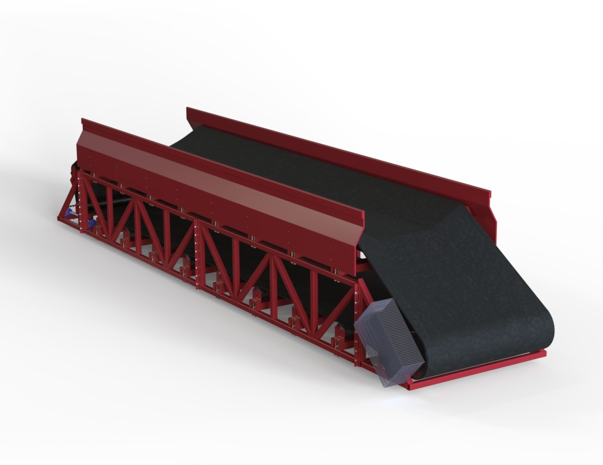

<a href="/proyectos/">Proyectos</a> / Cinta transportadora paramétrica

  <h1>Cinta transportadora paramétrica</h1>
  
El proyecto final del título propio de diseño asistido por ordenador de la Universidad de Vigo: una cinta para áridos que se alarga o se acorta cambiando un número, sin rediseñar ninguna pieza.

  

    
<b>Dónde</b>Título propio de SolidWorks avanzado, Universidad de Vigo

    
<b>Herramientas</b>SolidWorks, Toolbox, SolidWorks Visualize

  

<figure class="portada"></figure>

  
<h3>Modelado</h3>
Piezas, chapa metálica y ensamblajes diseñados de arriba abajo.

  
<h3>Parametrización</h3>
Ecuaciones globales y tablas de diseño que controlan longitud, rodillos y tornillería.

  
<h3>Presentación</h3>
Renders en SolidWorks Visualize con materiales y texturas realistas.

## El objetivo

El encargo no era solo dibujar una máquina, sino que el modelo aguantara cambios. Una cinta de áridos se pide con la longitud que necesita cada obra, y rehacer el chasis cada vez no tiene sentido.

## Un módulo que se repite

En vez de un chasis de 20 metros diseñé un módulo tipo de 3 metros y lo repetí. La longitud total es una variable: al cambiarla, el modelo recalcula cuántos módulos hacen falta y, con ellos, cuántos rodillos, soportes y tornillos lleva. Las relaciones de posición y los patrones lineales se apoyan en esas ecuaciones, así que nada se rompe al añadir o quitar tramos.




## Cabezal motriz y tensor

En el cabezal se juntan las piezas de chapa propias y los componentes comerciales. La tornillería sale de Toolbox y las partes móviles llevan protecciones según la normativa básica de seguridad en máquinas. En la cola, un tensor desliza el eje del tambor por unos raíles para tensar la banda.




<a href="/smart-hangboard">← Anterior: sensor de fuerza</a><a href="/proyectos/">Todos los proyectos →</a>

