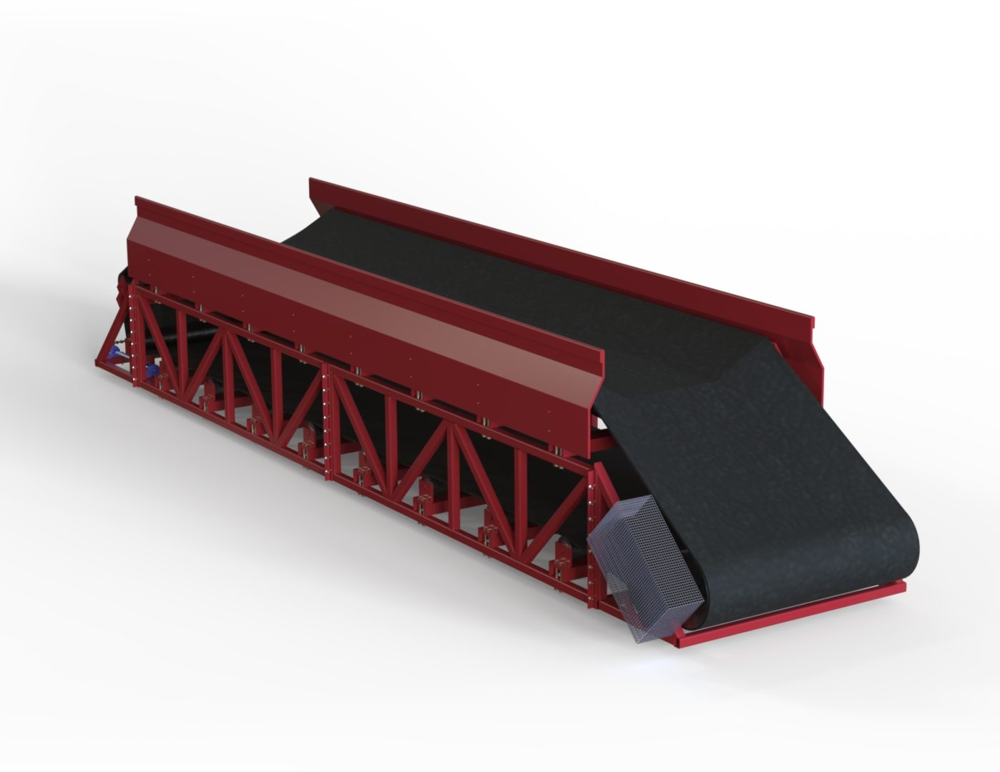

<a href="/en/projects/">Projects</a> / Parametric conveyor belt

  <h1>Parametric conveyor belt</h1>
  
The final project of the University of Vigo's computer-aided design course: an aggregate conveyor that gets longer or shorter by changing one number, without redesigning a single part.

  

    
<b>Where</b>Advanced SolidWorks course, University of Vigo

    
<b>Tools</b>SolidWorks, Toolbox, SolidWorks Visualize

  

<figure class="portada"></figure>

  
<h3>Modelling</h3>
Parts, sheet metal and top-down assemblies.

  
<h3>Parametrisation</h3>
Global equations and design tables controlling length, rollers and fasteners.

  
<h3>Presentation</h3>
Renders in SolidWorks Visualize with realistic materials and textures.

## The goal

The brief wasn't just to draw a machine, but for the model to survive changes. An aggregate conveyor is ordered at whatever length each site needs, and redrawing the chassis every time makes no sense.

## A module that repeats

Instead of a 20-metre chassis I designed a 3-metre standard module and repeated it. Total length is a variable: change it and the model works out how many modules are needed and, from that, how many rollers, supports and bolts it takes. Mates and linear patterns are driven by those equations, so nothing breaks when sections are added or removed.




## Drive head and tensioner

The drive head is where my own sheet-metal parts meet the off-the-shelf components. Fasteners come from Toolbox and the moving parts have guards following basic machinery safety rules. At the tail, a tensioner slides the drum shaft along rails to tension the belt.




<a href="/en/smart-hangboard/">← Previous: force sensor</a><a href="/en/projects/">All projects →</a>

