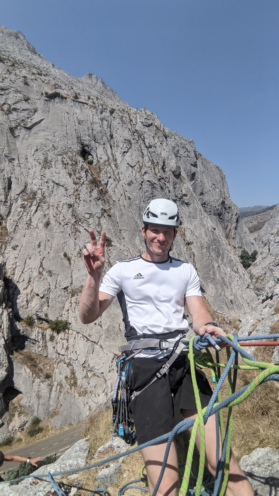

<section class="hola">
  
  

    <h1>Hi, I'm Fabio.</h1>
    
I study Mechanical Engineering at the University of Vigo (Spain), specialising in Design and Manufacturing, and all I have left is my final-year project: the design of a modular cryostat for the light sensors of the DUNE neutrino experiment.

    
I work as a mechanical engineer at <a href="/en/design-office/">EINGAL</a>, a design office in Pontevedra: I design in Inventor, run analyses in Nastran and produce building energy certificates with CE3X. Outside work I build things: a sim racing rig driven by an e-scooter motor, a home server that runs my flat, and a trading bot that taught me more by failing than by winning.

    
For each project I explain how I built it, what went wrong and what I learned.

    

      <a class="boton lleno" href="/en/projects/">See projects</a>
      <a class="boton" href="/en/resume/">Resume</a>
    

  

</section>

<h2 class="seccion-titulo">Projects</h2>

Pick one to see the details.









<section class="sobre" id="about">
  

    <h2>About me</h2>
    
I like to understand things by building them. Whatever I don't know I learn along the way, usually by getting it wrong first: the force sensor I machined in aluminium didn't measure properly, my bot's backtest showed impossible profits and the thermometer outside my flat was sitting in the sun. Each of those mistakes changed how I work.

    
I started climbing in 2020 and, from September 2024 to July 2026, volunteered as coach of the competition team at Grupo de Montaña Alud. That's where the finger-strength sensor came from.

    
From 2018 to 2025 I spent every summer working as a construction labourer: mixing mortar, moving materials and helping the foreman.

  

  

    <h3>What I work with</h3>
    <dl>
      <dt>Design</dt><dd>Autodesk Inventor, SolidWorks, Fusion 360, AutoCAD. Manufacturing drawings.</dd>
      <dt>Analysis</dt><dd>Linear and non-linear FEA in Inventor Nastran; also ANSYS, SolidWorks Simulation and CYPE. Bolted joints (VDI 2230, Rötscher) and beam models in Python.</dd>
      <dt>Energy</dt><dd>Building energy certification with CE3X.</dd>
      <dt>Fabrication</dt><dd>Design for manufacturing (CNC, welding, sheet metal, fibreglass), 3D printing, mechanical assembly.</dd>
      <dt>Electronics</dt><dd>Arduino and ESP32, load cells, Bluetooth LE.</dd>
      <dt>Software</dt><dd>Python, PowerShell, Linux, Docker, Home Assistant, Git. Claude Code to automate CAD and analysis work.</dd>
      <dt>Languages</dt><dd>Spanish and Galician (native), English (B1 certified, used daily), German (beginner).</dd>
    </dl>
  

</section>

<section class="contacto">
  <h2>Contact</h2>
  
If you'd like to ask about a project or talk about work, email me at  or reach me on <a href="https://linkedin.com/in/fabiocamposvillaverde" target="_blank" rel="noopener">LinkedIn</a>.

  <a class="boton" href="/en/contact/">Contact form</a>
</section>
