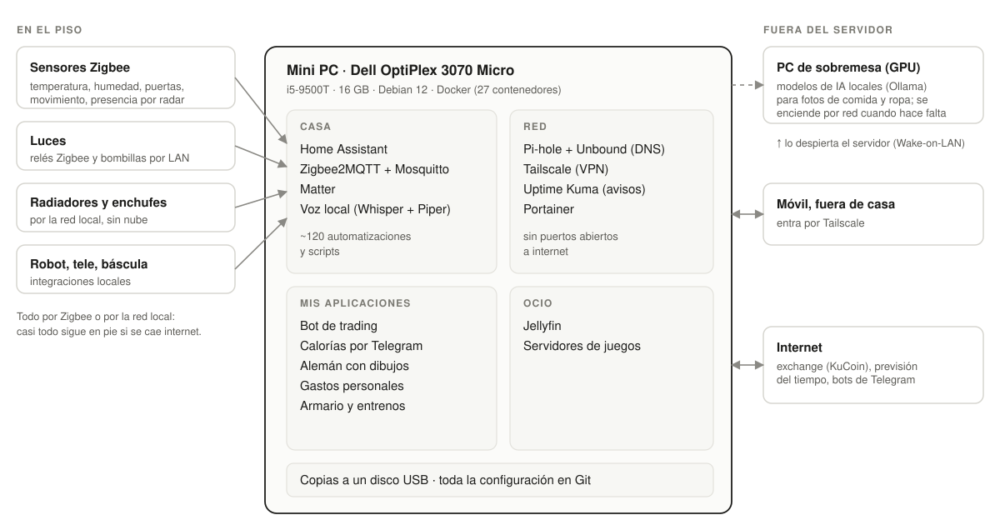

<a href="/en/projects/">Projects</a> / Home server

  <h1>A server at home</h1>
  
A mini PC on a shelf that runs my flat's home automation, the apps I write for myself and the trading bot. It started as a way to stop paying for a rented server and became the project I've learned the most from.

  

    
<b>Since</b>August 2026, running

    
<b>Hardware</b>Dell OptiPlex 3070 Micro, i5-9500T, 16 GB

    
<b>Software</b>Debian, Docker, Home Assistant, Zigbee2MQTT, Tailscale

  

<figure class="portada"></figure>

  
<h3>Systems</h3>
Linux, 27 Docker containers, backups, monitoring and remote access over a VPN with no open ports.

  
<h3>Home automation</h3>
Home Assistant with Zigbee sensors, around 120 automations and scripts, and devices controlled over the local network instead of the maker's cloud.

  
<h3>Measuring and modelling</h3>
Hourly temperature and humidity since August, a thermal model of the flat and a printed part to measure outdoors properly.

## Why

I had the trading bot on a rented server and an expenses app somewhere else. I was paying for something I could run at home and, above all, I wanted to understand what sits underneath a server instead of treating it as a black box. An OptiPlex Micro draws little power, makes no noise and is more than enough for everything I do.

## How it's set up

Each service runs in its own Docker container, with a pinned version and its configuration in a Git repository. Right now there are 27. No port is open to the internet: my ISP uses CG-NAT, so I couldn't anyway, and to get in from outside I use Tailscale, a VPN between my devices. I run my own DNS with Pi-hole and Unbound, Uptime Kuma tells me when something goes down and backups go to a USB drive.

Anything that needs a GPU doesn't run here. When there are food photos to analyse or clothes to tag, the server wakes my desktop PC over the network (Wake-on-LAN), uses its local AI models and leaves it as it was.

## The flat

Home Assistant is the hub. It has Zigbee sensors for temperature, humidity, doors, motion and radar presence, relays on the lights, and radiators and plugs I control over the local network. A few examples of what it does:

- The kitchen light turns on when I walk in if it's dark, and off by itself a minute later.
- When I wake up it sends me a short report: whether to open the window or the shutters, based on the forecast and the humidity inside.
- It warns me if a door is left open or a sensor stops reporting.
- A local voice assistant (Whisper and Piper) answers in under two seconds without touching the internet.



At first the rules were based on assumptions: that the sun came in during the morning, that closing the shutters cooled the flat... Once I started logging data, several of them turned out to be wrong.

## Measuring the flat

Using the sensor data I fitted a resistance-capacitance thermal model with two zones, the living room and the rest of the flat. With everything closed, the time constant comes out at **60 to 100 hours**: the flat takes days to follow the outside temperature. Closing the shutters barely cools it, and the only thing that really moves the temperature is ventilating at night.

I also measured things I thought I knew. The living room's glass doors face 171°, almost due south. And the living room is warmest at four in the afternoon, two hours after solar noon, because the tiled floor stores the heat and releases it later.



## A measurement bug that became a part

The outdoor thermometer read up to 17 °C too high in direct sun, and with that reading the ventilation advice came out backwards. I fixed it with a radiation shield like the ones on weather stations, designed parametrically in Python and printed in PETG.

The angled plates let air through but not sunlight. I checked that with ray tracing for the summer midday sun and for low sun. It has no screws at all: three printed rods run through the stack of plates and a wedge on each one clamps everything together. The script checks that parts don't collide and that the sensor fits before writing the STL files.

Before, next to the window frame, the sensor read about 2 °C high day and night. On its first night inside the shield it read 0.5 °C high. I still need to test it on a sunny day.




## What runs on top

- **The trading bot**, which has [its own page](/en/trading-bot/).
- **A calorie tracker on Telegram.** I log what I eat as text or a photo. The photos are analysed once a day by a vision model on the desktop PC. The model only says what's on the plate and how much it weighs, and the calories come from a table, so the same dish always gives the same number.
- **An app to learn German** with 357 words, each with a drawing, audio and seven kinds of exercise. I made it because flashcard apps didn't work for me.
- **Personal expense tracking**, importing bank statements.
- **Jellyfin and game servers** to play with friends.

## What went wrong

- **Alerts that went silent.** Several automations waited for a sensor to change state. If the sensor lost its connection and became "unavailable", the alert never fired and nothing said so. Now the important alerts also check that their sensor is alive.
- **The radiator that took my IP.** Presence at home was detected by pinging my phone. One day the router gave that IP to a radiator, and as far as the flat knew I never left. Presence is now cross-checked against two more sources.
- **I ran out of DNS.** While downloading data for the bot, thousands of queries per minute made Pi-hole rate-limit the server itself, and the bot lost contact with the exchange.
- **Freezes with no trace.** The mini PC has frozen a few times without leaving anything in the logs. A watchdog reboots it, and I suspect the RAM, which is two different modules, but I haven't confirmed it yet.

## What I learned

- That the hard part isn't getting a service running, it's finding out when it quietly stops working.
- To measure before automating. The data disproved half of my climate rules.
- I wrote much of the code and configuration with Claude Code, an AI tool. My job was deciding what to do, measuring the result and reviewing what it did, and that's where I learned the most.

<a href="/en/tfg-dune/">← Previous: final-year project</a><a href="/en/trading-bot/">Next: trading bot →</a>

