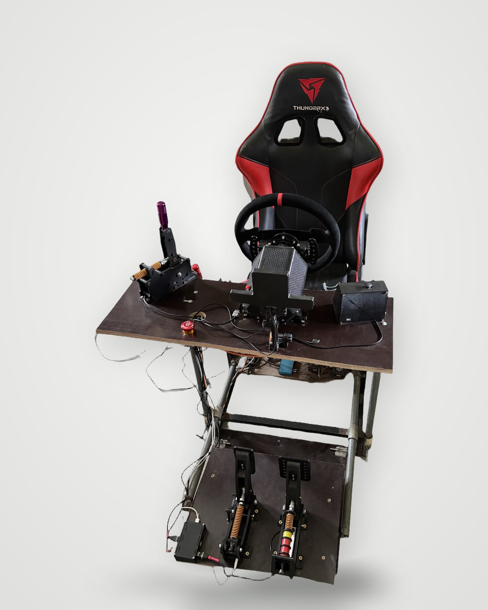

<a href="/en/projects/">Projects</a> / Sim racing rig

  <h1>Direct-drive sim racing rig</h1>
  
A driving simulator with 15 Nm of force feedback built on an electric scooter motor, pedals that measure force, a sequential shifter, a handbrake and shakers under the seat. Put together piece by piece in my garage at home.

  

    
<b>Tools</b>CAD, PETG 3D printing, Arduino, FFBeast, SimHub

  

<figure class="portada" style="max-width: 640px;"></figure>

  
<h3>Mechanical</h3>
Printed parts that take load, springs and elastomers, mounts and the rig structure.

  
<h3>Electronics</h3>
Load cells with HX711 amplifiers, Arduino as a USB controller and contactless Hall sensors.

  
<h3>Integration</h3>
The open-source FFBeast firmware for the motor and SimHub for the LEDs and shakers.

## Why

A commercial direct-drive base, where the wheel is mounted straight onto the motor shaft, costs hundreds of euros. I read that you could build one with the hub motor of an electric scooter and the open-source FFBeast project, and I wanted to see how far I could get doing it myself.

## The wheel base

FFBeast drives the motor and compensates for *cogging*, the small magnetic notches you feel when turning a permanent-magnet motor, so the wheel feels smooth. I designed its housing with forced ventilation and the mount to the desk. It peaks at 15 Nm.

On top sits an LED matrix showing gear and revs, and behind the wheel there are shift paddles.






## Pedals

I designed the pedals combining PETG printed parts with plates. The brake doesn't measure how far the pedal travels but how hard you press, with a 100 kg load cell, like a real car. The feel is tuned with elastomers of different hardness. The throttle uses a contactless Hall sensor so it doesn't wear.




## Sequential shifter and handbrake

The sequential shifter uses a spring-loaded cam that gives each gear its click. The handbrake has a 20 kg load cell, so it is also modulated by force, which is what you need to drift with control.





## Button box, LEDs and vibration

The button box has switches and buttons for the car's menus. Through SimHub the LEDs show gear, revs and race flags.

Under the seat and the pedals there are two old speakers used as bass shakers. Force feedback tells you what the front wheels are doing; the shakers tell you the rest: bumps, the engine at idle or a locking wheel.





| Part | How it works | Electronics and software |
|---|---|---|
| Base | E-scooter hub motor, 15 Nm peak | FFBeast |
| Pedals | 100 kg load cell on the brake, Hall sensor on the throttle | Arduino as a USB controller |
| Handbrake | 20 kg load cell | Arduino Pro Micro + HX711 |
| LEDs | Matrix and RGB strip | SimHub |
| Vibration | Recycled speakers as shakers | SimHub |

## What went wrong

The Arduino side caused the most trouble. The pedals, the handbrake and the other controls run on several boards plugged into the PC over USB, and with so many at once they started failing: they couldn't capture all the information from every side.

## What I learned

- That connecting things is harder than building them. Each part worked on its own; the problems appeared when they all had to work together.

<a href="/en/trading-bot/">← Previous: trading bot</a><a href="/en/smart-hangboard/">Next: force sensor →</a>

