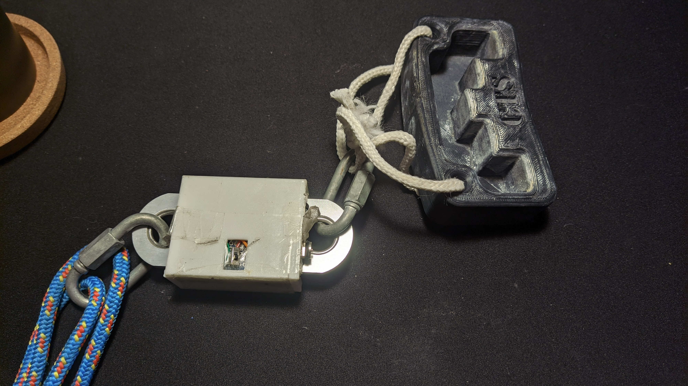

<a href="/en/projects/">Projects</a> / Climbing force sensor

  <h1>Climbing force sensor</h1>
  
A portable finger-strength meter for training. It took three versions: the first only tested the communication, the second, with a sensor I machined in aluminium, didn't measure properly, and the third is the one I use.

  

    
<b>Tools</b>ESP32, HX711, Bluetooth LE, MIT App Inventor, 3D printing, CNC

  

<figure class="portada" style="max-width: 760px;"></figure>

  
<h3>Mechanical design</h3>
Sensor body, an aluminium transducer machined on a CNC and interchangeable 3D-printed edges.

  
<h3>Electronics</h3>
Full Wheatstone bridge load cell, HX711 amplifier and ESP32.

  
<h3>Software</h3>
My own Android app and firmware that mimics the Bluetooth protocol of a commercial sensor.

## Why

In climbing you train finger strength by hanging from edges. Measuring it tells you whether you're improving and keeps you from overdoing it, but commercial sensors are expensive and closed. I wanted my own and to understand how they work inside.

## Version 1: testing the communication

Before thinking about the mechanics I wanted to know whether I could read a load cell and see the force on my phone in real time. The first version was a plastic box with a board, a battery and wires, plus an Android app made with MIT App Inventor that plots the force curve and exports the data to CSV.




## Version 2: the aluminium transducer that didn't work

For the second version I wanted to make my own force sensor: a CNC-machined aluminium part that acts as a transducer by deforming under load. The readings weren't consistent: when the load came off they didn't return to the same value. My deformation calculations hadn't properly accounted for hysteresis.

I could have kept refining the design, but I realised that making a reliable transducer is a project in itself. To measure well, it made more sense to use a calibrated industrial load cell and spend the effort on everything else.



## Version 3: the one I use

It has an industrial load cell (full Wheatstone bridge), an HX711 and an ESP32. The firmware mimics the Bluetooth protocol of a commercial climbing sensor, so it works with existing training apps as well as with mine. It samples at 50 Hz.

In parallel I made a fixed version for the climbing gym with interchangeable 3D-printed edges. Instead of one sensor per edge depth, a single sensor core and a quick-release mount switch between 10 mm, 20 mm or a sloper in seconds.



## What I learned

- To separate what adds value from what is better bought. The commercial load cell gave me the accuracy, and my own design is in everything around it.
- To test the riskiest part first. Version 1 was ugly, but it confirmed the electronics and app worked before I spent anything on machining.

<a href="/en/simulador-racing/">← Previous: sim rig</a><a href="/en/cinta-modular/">Next: parametric conveyor →</a>

