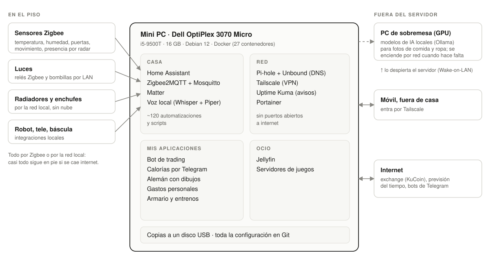

<a href="/proyectos/">Proyectos</a> / Servidor casero

  <h1>Un servidor en casa</h1>
  
Un mini PC en una estantería que lleva la domótica del piso, las aplicaciones que me hago y el bot de trading. Empezó para dejar de pagar un servidor alquilado y ha acabado siendo el proyecto en el que más he aprendido.

  

    
<b>Desde</b>Agosto de 2026, en marcha

    
<b>Hardware</b>Dell OptiPlex 3070 Micro, i5-9500T, 16 GB

    
<b>Software</b>Debian, Docker, Home Assistant, Zigbee2MQTT, Tailscale

  

<figure class="portada"></figure>

  
<h3>Sistemas</h3>
Linux, 27 contenedores Docker, copias de seguridad, monitorización y acceso desde fuera por VPN sin abrir puertos.

  
<h3>Domótica</h3>
Home Assistant con sensores Zigbee, unas 120 automatizaciones y scripts, y aparatos controlados por la red local en vez de por la nube del fabricante.

  
<h3>Medir y modelar</h3>
Datos horarios de temperatura y humedad desde agosto, un modelo térmico de la casa y una pieza impresa para medir bien fuera.

## Por qué

Tenía el bot de trading en un servidor alquilado y una aplicación de gastos en otro sitio. Pagaba por algo que podía tener en casa y, sobre todo, quería entender qué hay debajo de un servidor en vez de usarlo como una caja negra. Un OptiPlex Micro consume poco, no hace ruido y sobra para todo lo que hago.

## Cómo está montado

Cada servicio corre en su contenedor Docker, con su versión fijada y su configuración en un repositorio Git. Ahora mismo son 27. No hay ningún puerto abierto a internet: mi operadora usa CG-NAT, así que tampoco podría, y para entrar desde fuera uso Tailscale, una VPN entre mis dispositivos. El DNS de casa lo resuelvo yo con Pi-hole y Unbound, Uptime Kuma me avisa si algo se cae y las copias van a un disco USB.

Lo que necesita GPU no corre aquí. Cuando hay fotos de comida que analizar o ropa que etiquetar, el servidor enciende mi PC de sobremesa por la red (Wake-on-LAN), usa sus modelos de IA locales y lo vuelve a dejar como estaba.

## La casa

Home Assistant es el centro. Tiene sensores Zigbee de temperatura, humedad, puertas, movimiento y presencia por radar, relés en las luces y radiadores y enchufes que controlo por la red local. Algunos ejemplos de lo que hace:

- La luz de la cocina se enciende al entrar si está oscuro y se apaga sola al minuto.
- Al despertarme me manda un parte: si conviene abrir la ventana o las contras según la previsión y la humedad de dentro.
- Avisa si una puerta se queda abierta o si un sensor deja de dar datos.
- Un asistente de voz local (Whisper y Piper) contesta en menos de dos segundos sin pasar por internet.



Al principio las reglas se basaban en suposiciones: que el sol entraba por la mañana, que cerrar las contras enfriaba la casa... Cuando empecé a guardar datos, varias resultaron falsas.

## Medir la casa

Con los datos de los sensores ajusté un modelo térmico de resistencias y capacidades con dos zonas, el salón y el resto del piso. Con todo cerrado, la constante de tiempo sale de **60 a 100 horas**: el piso tarda días en seguir a la calle. Cerrar las contras apenas enfría, y lo único que mueve la temperatura de verdad es ventilar de noche.

También medí cosas que creía saber. La cristalera del salón mira a 171°, casi al sur. Y el salón se calienta más a las cuatro de la tarde, dos horas después del mediodía solar, porque el suelo de plaqueta guarda el calor y lo suelta después.



## Un fallo de medida que acabó en pieza

El termómetro de fuera llegaba a marcar 17 °C de más cuando le daba el sol, y con ese dato los consejos de ventilar salían al revés. Lo arreglé con una garita, una pantalla de radiación como las de las estaciones meteorológicas, diseñada en Python de forma paramétrica para imprimirla en PETG.

Los platos inclinados dejan pasar el aire y no el sol. Lo comprobé con un trazado de rayos para el sol de mediodía en verano y para el sol bajo. No lleva ni un tornillo: tres varillas impresas atraviesan la pila de platos y una cuña en cada una lo aprieta todo. El script comprueba que las piezas no chocan y que el sensor cabe antes de generar los STL.

Antes, junto al marco de la ventana, el sensor marcaba unos 2 °C de más de día y de noche. La primera noche dentro de la garita, 0,5 °C. Me falta medirlo en un día de sol.




## Lo que corre encima

- **El bot de trading**, que tiene [su propia página](/trading-bot).
- **Un contador de calorías por Telegram.** Apunto lo que como con texto o con una foto. Las fotos las analiza un modelo de visión en el PC una vez al día. El modelo solo dice qué hay y cuánto pesa, y las calorías salen de una tabla, así que el mismo plato da siempre el mismo número.
- **Una app para aprender alemán** con 357 palabras, cada una con su dibujo, audio y siete tipos de ejercicio. La hice porque las de fichas sueltas no me funcionaban.
- **Control de gastos personales**, importando los extractos del banco.
- **Jellyfin y servidores de juegos** para jugar con amigos.

## Qué salió mal

- **Avisos que se callaban solos.** Varias automatizaciones esperaban a que un sensor cambiara de estado. Si el sensor perdía la conexión y pasaba a «no disponible», el aviso no saltaba nunca y nada lo decía. Ahora los avisos importantes comprueban también que su sensor sigue vivo.
- **El radiador que se quedó mi IP.** La presencia en casa se detectaba haciendo ping al móvil. Un día el router le dio esa IP a un radiador y para la casa yo no me iba nunca. Ahora la presencia se cruza con dos fuentes más.
- **Me quedé sin DNS.** Descargando datos para el bot, miles de consultas por minuto hicieron que Pi-hole limitara al propio servidor, y el bot dejó de ver el exchange.
- **Cuelgues sin rastro.** El mini PC se ha colgado alguna vez sin dejar nada en los registros. Tiene un watchdog que lo reinicia y sospecho de la RAM, que es de dos módulos distintos, pero aún no lo he confirmado.

## Qué aprendí

- Que lo difícil no es poner un servicio en marcha, sino enterarte de cuándo deja de funcionar sin decir nada.
- A medir antes de automatizar. Los datos desmintieron la mitad de mis reglas de clima.
- A trabajar con un asistente de IA, Claude Code, para escribir código y configuración. Yo decido qué se hace y con qué criterio, mido el resultado y reviso lo que entrega. Es la misma forma de trabajar que ahora uso en la oficina técnica.

<a href="/tfg-dune">← Anterior: TFG</a><a href="/trading-bot">Siguiente: bot de trading →</a>

