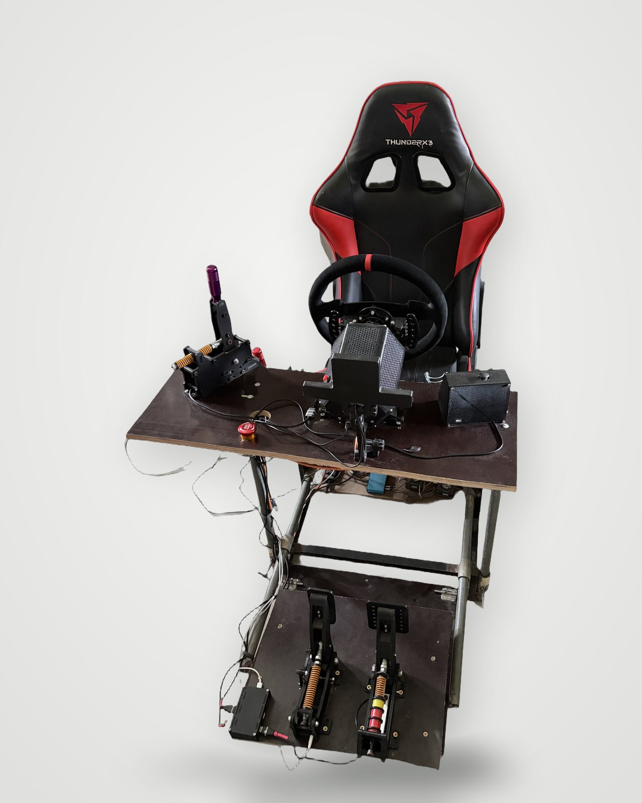

<a href="/proyectos/">Proyectos</a> / Simulador de conducción

  <h1>Simulador de conducción direct drive</h1>
  
Un simulador con force feedback de 15 Nm hecho con el motor de un patinete eléctrico, pedales que miden fuerza, cambio secuencial, freno de mano y vibradores bajo el asiento. Montado pieza a pieza en el garaje de casa.

  

    
<b>Herramientas</b>CAD, impresión 3D en PETG, Arduino, FFBeast, SimHub

  

<figure class="portada" style="max-width: 640px;"></figure>

  
<h3>Mecánica</h3>
Piezas impresas que aguantan carga, muelles y elastómeros, soportes y la estructura del puesto.

  
<h3>Electrónica</h3>
Células de carga con amplificador HX711, Arduino como mando USB y sensores Hall sin contacto.

  
<h3>Integración</h3>
El firmware abierto FFBeast para el motor y SimHub para los LED y los vibradores.

## Por qué

Una base direct drive comercial, en la que el volante va montado directamente sobre el eje del motor, cuesta cientos de euros. Leí que se podía hacer con el motor de buje de un patinete eléctrico y el proyecto abierto FFBeast, y quise ver hasta dónde llegaba haciéndolo yo.

## La base del volante

FFBeast controla el motor y compensa el *cogging*, los pequeños tirones magnéticos que se notan al girar un motor de imanes, para que el volante se sienta suave. Le diseñé la carcasa con ventilación forzada y el soporte al tablero. Da picos de 15 Nm.

Encima va una matriz de LED que marca la marcha y las revoluciones, y detrás del volante, levas para cambiar.






## Pedales

Los pedales los diseñé combinando piezas impresas en PETG con placas. El freno no mide cuánto se hunde el pedal sino cuánta fuerza haces, con una célula de carga de 100 kg, como en un coche real. El tacto se cambia con elastómeros de distinta dureza. El acelerador usa un sensor Hall, sin contacto, para que no se desgaste.




## Cambio secuencial y freno de mano

El cambio secuencial usa una leva con muelle que da el golpe de cada marcha. El freno de mano lleva una célula de carga de 20 kg, así que también se modula por fuerza, que es lo que hace falta para derrapar con control.





## Botonera, LED y vibración

La botonera tiene interruptores y botones para los menús del coche. Con SimHub, los LED muestran la marcha, las revoluciones y las banderas de carrera.

Debajo del asiento y de los pedales hay dos altavoces viejos usados como vibradores (*bass shakers*). El force feedback cuenta lo que hacen las ruedas delanteras; los vibradores, el resto: baches, el motor al ralentí o una rueda que se bloquea.





| Parte | Cómo funciona | Electrónica y software |
|---|---|---|
| Base | Motor de buje de patinete, 15 Nm de pico | FFBeast |
| Pedales | Célula de carga de 100 kg en el freno, Hall en el acelerador | Arduino como mando USB |
| Freno de mano | Célula de carga de 20 kg | Arduino Pro Micro + HX711 |
| LED | Matriz y tira RGB | SimHub |
| Vibración | Altavoces reciclados como vibradores | SimHub |

## Qué salió mal

Lo que más problemas dio fue la parte de Arduino. Pedales, freno de mano y el resto de mandos van con varias placas conectadas al PC por USB, y con tantas a la vez empezaron los fallos: no conseguían recoger toda la información de todos los lados.

## Qué aprendí

- Que conectar es más difícil que construir. Cada parte funcionaba sola; los problemas aparecieron al tener que funcionar todas juntas.

<a href="/trading-bot">← Anterior: bot de trading</a><a href="/smart-hangboard">Siguiente: sensor de fuerza →</a>

