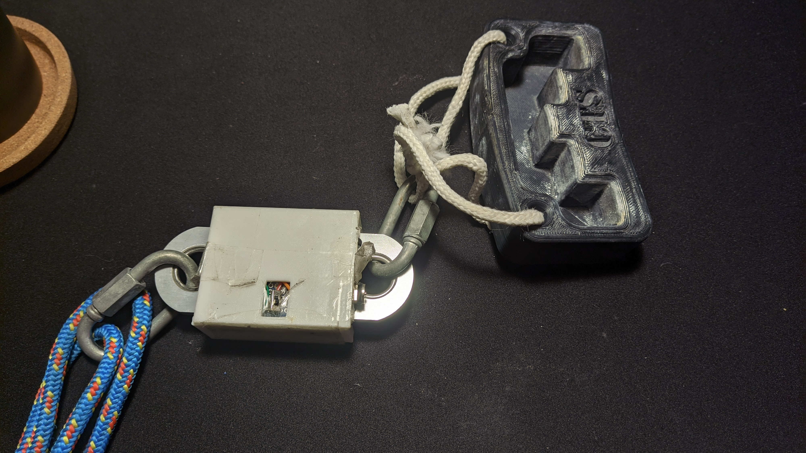

<a href="/proyectos/">Proyectos</a> / Sensor de fuerza para escalada

  <h1>Sensor de fuerza para escalada</h1>
  
Un medidor portátil de la fuerza de dedos para entrenar. Hicieron falta tres versiones: la primera solo probaba la comunicación, la segunda, con un sensor mecanizado por mí en aluminio, no medía bien, y la tercera es la que uso.

  

    
<b>Herramientas</b>ESP32, HX711, Bluetooth LE, MIT App Inventor, impresión 3D, CNC

  

<figure class="portada" style="max-width: 760px;"></figure>

  
<h3>Diseño mecánico</h3>
Cuerpo del sensor, un transductor mecanizado en aluminio y regletas intercambiables impresas en 3D.

  
<h3>Electrónica</h3>
Célula de carga en puente de Wheatstone completo, amplificador HX711 y ESP32.

  
<h3>Software</h3>
Una app Android propia y un firmware que imita el protocolo Bluetooth de un sensor comercial.

## Por qué

En escalada, la fuerza de dedos se entrena colgándose de regletas. Medirla ayuda a saber si mejoras y a no pasarte, pero los sensores comerciales son caros y cerrados. Quería uno propio y entender cómo funciona por dentro.

## Versión 1: probar la comunicación

Antes de pensar en la mecánica quería saber si podía leer una célula de carga y ver la fuerza en el móvil en tiempo real. La primera versión era una caja de plástico con una placa, una pila y cables, y una app Android hecha con MIT App Inventor que dibuja la curva de fuerza y exporta los datos a CSV.




## Versión 2: el transductor de aluminio que no funcionó

Para la segunda versión quise hacer mi propio sensor de fuerza: una pieza de aluminio mecanizada en CNC que hace de transductor al deformarse con la carga. Las lecturas no eran consistentes: al descargar peso no volvían al mismo valor. En mis cálculos de deformación no había tenido bien en cuenta la histéresis.

Podría haber seguido ajustando el diseño, pero entendí que fabricar un transductor fiable es un proyecto en sí mismo. Para medir bien, era más sensato usar una célula de carga industrial ya calibrada y dedicar el esfuerzo al resto.



## Versión 3: la que uso

Lleva una célula de carga industrial (puente de Wheatstone completo), un HX711 y un ESP32. El firmware imita el protocolo Bluetooth de un sensor comercial de escalada, así que funciona con las apps de entrenamiento que ya existen, además de con la mía. Mide a 50 Hz.

En paralelo hice una versión fija para el rocódromo con regletas intercambiables impresas en 3D. En vez de un sensor por cada profundidad de regleta, un solo núcleo sensor y un acople rápido para cambiar entre 10 mm, 20 mm o un romo en segundos.



## Qué aprendí

- A separar lo que aporta valor de lo que es mejor comprar hecho. La célula de carga comercial me dio la precisión, y el diseño propio está en todo lo de alrededor.
- A probar primero la parte con más riesgo. La versión 1 era fea, pero me confirmó que la electrónica y la app funcionaban antes de gastar en mecanizado.

<a href="/simulador-racing">← Anterior: simulador</a><a href="/cinta-modular">Siguiente: cinta paramétrica →</a>

